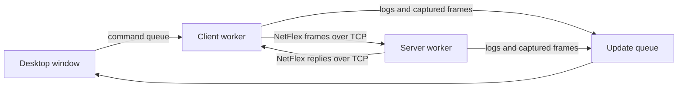

# NetFlex Application Level Protocol

NetFlex is a Computer Networks project that implements a small custom
application-layer protocol over TCP in C++17. It includes a Windows desktop app
with integrated client and server terminals, a message history, and an animated
view of the actual NetFlex header bytes.

**TCP carries the bytes. NetFlex defines their format, meaning, and boundaries.**
This project does not modify TCP or implement a replacement for it.

## Download and run

[Download NetFlex.exe](https://github.com/WarMachine108/Netflex-Application-level-protocol/releases/latest/download/NetFlex.exe) from the latest
release and double-click it on a Windows 10/11 x64 computer.

The single executable starts the local server and client automatically. No compiler
is needed to run the downloaded app. The server binds to port **54000** and the
client connects to **127.0.0.1:54000**. Run one demo instance at a time so the port
is available.

If you prefer to build the executable yourself, follow the instructions below.

## What it does

- Exchanges several text messages on the same TCP connection.
- Supports Text echo, Ping/Pong, Goodbye, and Error messages.
- Uses an eight-byte header with a marker, version, type, and payload length.
- Handles partial sends and receives instead of assuming one call is one message.
- Validates incoming headers and limits payloads to **65,536 bytes**.
- Shows both terminals inside the app, with command history and reconnect controls.
- Captures actual completed message sends and receives for the byte inspector.
- Keeps the original standalone console client and server in the source tree.

## Try it

Type in the **client input box** and press Enter or click Send:

```text
> Hello
Server echoed: Hello
> /ping
Pong received.
> /quit
Conversation closed.
```

Click **Reconnect** to start a fresh conversation after `/quit`. Click **Run sample**
to send two text messages and a Ping automatically. An empty line sends an empty
Text message.

### Client commands in the desktop app

| Input | Action |
|---|---|
| Ordinary text | Send a Text message and display the echoed reply |
| `/ping` | Send Ping and expect Pong |
| `/quit` | Exchange Goodbye and end the session |
| `/help` | Show local command help |
| `/clear` | Clear the client terminal display |
| `/demo` | Run the sample conversation |
| Up / Down keys | Recall previously sent commands |

`/help`, `/clear`, and `/demo` are handled by the interface. `/ping` and `/quit`
become message types with empty payloads; the command words themselves are not sent.

### Server commands in the desktop app

| Input | Action |
|---|---|
| `/status` | Show whether the server and client are active |
| `/clear` | Clear the server terminal display |
| `/restart` | Restart both sides of the local demo |
| `/help` | List the server's local commands |

The server normally responds automatically. Its input box is for local controls,
not a second chat user.

## Read the byte display

Sending `Hello` produces these application bytes:

```text
4E 46 | 01 | 01 | 00 00 00 05 | 48 65 6C 6C 6F
  NF     v1  Text    length 5          Hello
```

| Field | Size | Purpose |
|---|---:|---|
| Marker | 2 bytes | Identify NetFlex with ASCII `NF` |
| Version | 1 byte | Select protocol version 1 |
| Type | 1 byte | Identify Text, Ping, Pong, Goodbye, or Error |
| Payload length | 4 bytes | State how many payload bytes follow, in big-endian order |
| Payload | 0–65,536 bytes | Carry the message content |

Select a message in **Message history** to inspect its header and payload preview.
**Replay frame** restarts the animation from that selected message.

The animation is deliberately slowed down for explanation. It represents captured
application messages, not measured TCP segment timing or a packet-sniffer capture.
The inspector retains the latest 256 frames and previews up to 64 payload bytes;
the hex payload line shows its first 16 bytes. The full valid payload is still sent.

The Sent/Received counters observe both endpoints. One Text request plus its echo
means **2 sent frames and 2 received frames**. Bytes counts the NetFlex header and
payload sent in both directions, excluding TCP/IP and link-layer overhead.

## Build from source

### Requirements

- Windows 10/11 x64.
- A MinGW-w64 C++17 compiler with thread support, available as `g++` in PATH.
- PowerShell. Git is useful for cloning the repository.

The project was built locally with MinGW-w64 GCC 12.2.0, using its POSIX thread
variant. The sources currently include GCC's `bits/stdc++.h`, so these instructions
target MinGW rather than MSVC.

```powershell
git clone https://github.com/WarMachine108/Netflex-Application-level-protocol.git
cd Netflex-Application-level-protocol
powershell -NoProfile -ExecutionPolicy Bypass -File .\build.ps1
.\NetFlex.exe
```

Close a running `NetFlex.exe` before rebuilding. The build script links the desktop
interface, session threads, networking layer, and protocol layer into one executable.
The app uses Windows-provided UI/networking libraries; there is no browser frontend,
Python runtime, CMake setup, or external web server required.

### Optional: build the original console programs

```powershell
g++ -std=c++17 -Wall -Wextra -Wpedantic src/client.cpp src/network.cpp src/protocol.cpp -lws2_32 -o client.exe
g++ -std=c++17 -Wall -Wextra -Wpedantic src/server.cpp src/network.cpp src/protocol.cpp -lws2_32 -o server.exe
```

Run `server.exe` in one terminal, then `client.exe` in another. These console versions
support ordinary text, `/ping`, and `/quit`. The desktop-only helpers `/help`, `/clear`,
and `/demo` are not special commands in the console client.

## Source layout

```text
Netflex-Application-level-protocol/
  build.ps1                 Build the Windows desktop executable
  README.md                 Setup, usage, and overview
  docs/
    PROTOCOL.md             Exact message format and conversation rules
    ARCHITECTURE.md         Modules, threads, queues, and function reference
    DEMO.md                 Demonstration steps and troubleshooting
  src/
    protocol.h/.cpp         Message definitions, framing, encoding, validation
    network.h/.cpp          Winsock lifetime, socket ownership, byte-transfer loops
    client.cpp             Original console client
    server.cpp             Original console server
    desktop.cpp            Windows controls, commands, and byte display
    desktop_session.h/.cpp  Client/server worker threads and interface updates
```

## How it works



The client and server run as two threads in one desktop process, but they communicate
through real TCP sockets. A mutex protects shared queues and state; a condition
variable wakes workers when startup completes or a command arrives. The UI polls
updates every 40 ms. Network operations run in the workers so the window remains usable.

Read [the architecture guide](docs/ARCHITECTURE.md) for the function-by-function map
and [the protocol specification](docs/PROTOCOL.md) for the exact bytes and checks.

## Limits of this version

- Windows-only desktop UI, Winsock networking, numeric IPv4, and a fixed port.
- The bundled client connects to localhost; the app does not offer a remote-host field.
  The server binds all local IPv4 interfaces. A separate-machine client currently
  requires changing its hardcoded destination and rebuilding, plus network/firewall access.
- One client conversation at a time; use Reconnect to start another desktop session.
- No encryption, authentication, file transfer, or simultaneous multi-user chat.
- Blocking network operations have no receive deadline. This is a trusted-network
  learning demonstration, not a production service.
- Payload lengths count bytes, not characters. UTF-8 text is transported unchanged;
  the byte inspector's printable preview is ASCII-oriented.

For a classroom walkthrough and common startup errors, see [the demo guide](docs/DEMO.md).

## Background

The initial project idea was inspired by
[hoff-dot-world/netflex](https://github.com/hoff-dot-world/netflex). This repository
contains the Windows C++ client/server demonstration, desktop interface, and protocol
implementation developed for this project.
